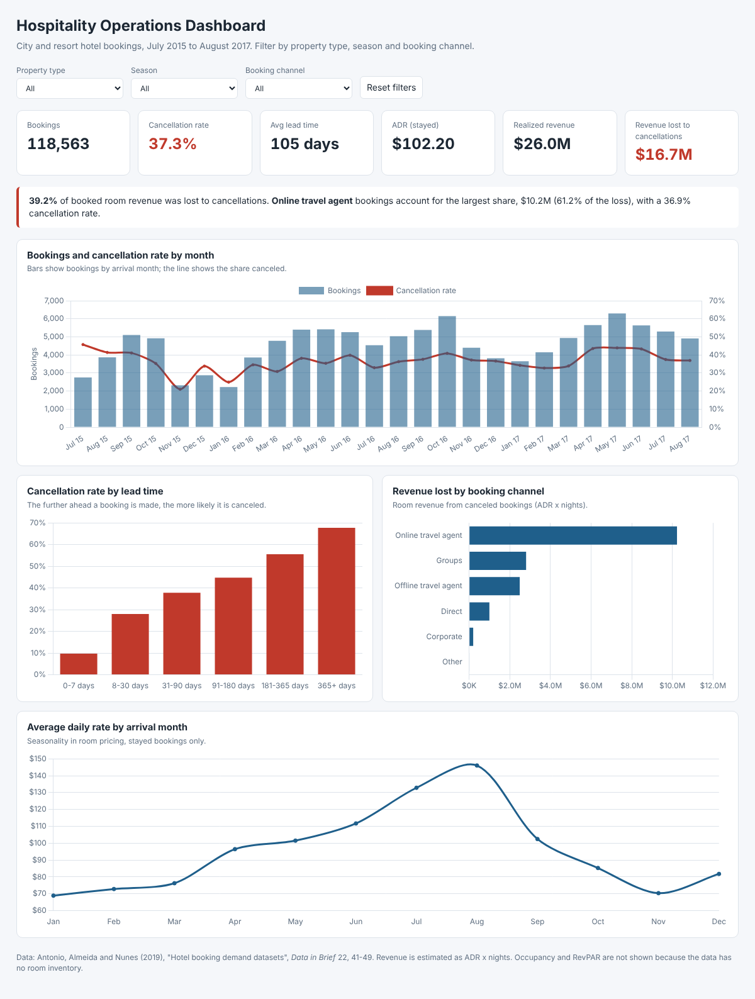

# Hospitality Operations Dashboard

Where are two hotels losing revenue, and what drives cancellations?

An interactive dashboard over 118,563 hotel bookings that tracks bookings, cancellations, lead times, average daily rate and revenue lost to cancellations, filterable by property type, season and booking channel.

**Tools:** Python (pandas), HTML and Chart.js for the interactive dashboard, Power BI build guide with DAX measures



**Open the dashboard:** download `dashboard/index.html` and open it in any browser, or enable GitHub Pages for this repository and open `/dashboard/`.

## Key findings

| Metric | Result |
| --- | --- |
| Bookings analyzed | 118,563 (City Hotel 78,898, Resort Hotel 39,665) |
| Cancellation rate | 37.3% |
| Average lead time | 105 days |
| Average daily rate (stayed bookings) | $102.20 |
| Realized room revenue | $26.0M |
| Room revenue lost to cancellations | $16.7M (39.2% of booked revenue) |

1. **Revenue leakage is large.** Nearly 4 in 10 booked revenue dollars never arrive because the booking is canceled.
2. **Lead time predicts cancellation.** Bookings made within a week cancel 9.7% of the time. Bookings made more than a year ahead cancel 67.7% of the time.
3. **Online travel agents drive most of the loss.** They account for $10.2M of lost revenue, 61% of the total, with a 36.9% cancellation rate.
4. **Group bookings cancel most often**, at 61.2%.
5. **Direct and corporate bookings are the most reliable**, at 15.5% and 18.9% cancellation.
6. **The City Hotel cancels more** than the Resort Hotel (41.9% vs 28.0%).
7. **Strong seasonality in price.** ADR peaks around $146 in August and drops to about $69 in January.

## Recommendations

| Finding | Recommendation |
| --- | --- |
| Long-lead bookings cancel most | Require a deposit, or use a stricter cancellation window, for bookings made 90+ days out |
| Online travel agents cause 61% of lost revenue | Shift demand to direct booking with member rates or perks |
| Groups cancel 61% of the time | Use staged deposits and release deadlines for group blocks |
| Cancellations are predictable from lead time and channel | Use controlled overbooking on high-risk segments to protect occupancy |

## Project structure

```
hospitality-operations-dashboard/
├── data/hotel_bookings.csv              raw data (119,390 bookings)
├── src/prepare_data.py                  cleaning, metrics, builds the dashboard
├── src/dashboard_template.html          dashboard layout and chart code
├── dashboard/index.html                 the finished interactive dashboard
├── outputs/hotel_bookings_clean.csv     clean booking-level data for Power BI or Tableau
├── outputs/summary_by_hotel_channel.csv summary table
├── powerbi/dax_measures.md              how to rebuild the dashboard in Power BI
└── docs/dashboard_preview.png
```

## Metrics

| Metric | Definition |
| --- | --- |
| Cancellation rate | Canceled bookings / all bookings |
| Lead time | Days between booking and arrival |
| ADR | Realized room revenue / nights stayed (non-canceled bookings) |
| Booking revenue | ADR x nights for each booking |
| Revenue lost | Booking revenue of canceled bookings |

**Why no occupancy or RevPAR?** Both need the number of rooms available each night, which this dataset does not include. ADR and revenue lost are used instead.

## Data cleaning

827 of 119,390 rows were removed:

- 715 zero-night stays
- 110 bookings with zero guests
- 2 rows with impossible ADR (negative, or above $1,000)

Added columns: arrival month and season, booking channel (from market segment), lead-time band, and booking, realized and lost revenue.

## How to run

```bash
pip install pandas
python src/prepare_data.py
```

This prints the headline numbers and rebuilds `outputs/` and `dashboard/index.html`.

## Data source

Nuno Antonio, Ana de Almeida and Luis Nunes (2019), "Hotel booking demand datasets", *Data in Brief* 22, 41-49. Real booking data from two hotels in Portugal, anonymized. Downloaded from the [TidyTuesday](https://github.com/rfordatascience/tidytuesday/tree/master/data/2020/2020-02-11) repository.

Note: almost all "Non Refund" deposit bookings are marked canceled (99.4%). This is a known quirk of the source data, so deposit type is not used as a finding.
